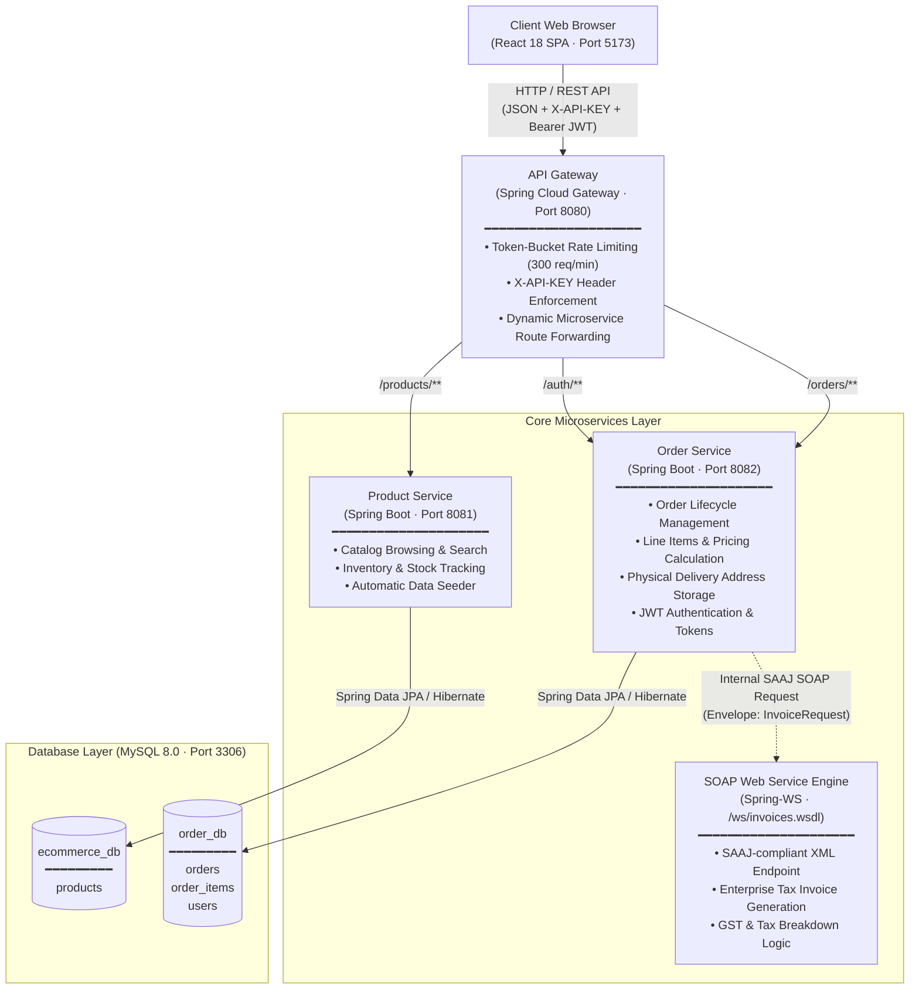

# 🛍️ ShopEase — Modern Microservices E-Commerce Platform

A production-grade, distributed e-commerce application built with **Spring Boot 3**, **Spring Cloud Gateway**, **Spring-WS (SOAP)**, **React 18 + Vite**, and **MySQL**. 

ShopEase implements a clean microservices architecture featuring catalog management with high-resolution imagery, cart and checkout flows with delivery address tracking, secure JWT authentication, and enterprise tax invoice generation via SOAP.

---

## 🏛️ System Architecture

The following diagram illustrates the complete end-to-end architecture and communication flow between the client, API gateway, microservices, and database layer:



---

## 🧩 Architectural Components

### 1. API Gateway (`api-gateway` · Port `8080`)
- **Technology**: Spring Cloud Gateway (Spring WebFlux)
- **Unified Entry Point**: Proxies incoming traffic to underlying microservices based on URL path predicates (`/products/**`, `/orders/**`, `/auth/**`).
- **Security & Integrity**: Validates the global `X-API-KEY` header (`ecommerce-secret-key`) on all inbound requests.
- **Rate Limiting**: Protects downstream services with a token-bucket rate limiter (300 requests/minute), with exemptions for critical health and invoice routes.

### 2. Product Service (`product-service` · Port `8081`)
- **Technology**: Spring Boot 3, Spring Data JPA, MySQL
- **Catalog Management**: Provides endpoints to list, query, and search catalog products across diverse categories (Electronics, Fashion, Sports & Fitness, Groceries, Books, Home & Living).
- **Auto Data Seeder**: Automatically initializes missing items and configures verified local product imagery upon startup.

### 3. Order Service (`order-service` · Port `8082`)
- **Technology**: Spring Boot 3, Spring Data JPA, Spring-WS, MySQL, JJWT
- **Order Lifecycle**: Handles order placement, line item addition, real-time price recalculation, and order cancellations.
- **Physical Delivery Address**: Persists full delivery destination details (Street, City, State, Postal PIN Code, and Recipient Phone Number) directly in the `orders` entity.
- **JWT Authentication**: Issues signed HMAC-SHA256 tokens for authenticated user sessions.
- **Resilient Invoicing**: Dispatches SAAJ SOAP requests to generate official enterprise tax invoices, with an automatic database fallback for 100% uptime.

### 4. Frontend Application (`frontend` · Port `5173`)
- **Technology**: React 18, Vite, Vanilla CSS Design System
- **Rich User Experience**: Modern typography, bento-grid cards, smooth transitions, live category filtering, and responsive steppers.
- **Interactive Checkout**: Includes quick shipping presets (**Home**, **Office**, **Custom**) with postal PIN validation.
- **A4 Printable Tax Invoice**: Formatted invoice document featuring itemized tables, 18% GST calculation (CGST + SGST), amount in words, and digital seal.

---

## 🛠️ Technology Stack

| Layer | Technologies |
| :--- | :--- |
| **Backend Framework** | Java 17, Spring Boot 3.x, Spring Data JPA, Hibernate |
| **API Gateway** | Spring Cloud Gateway (Reactive / WebFlux) |
| **Web Services** | Spring-WS (SOAP 1.1 SAAJ, WSDL generation) |
| **Security** | JJWT (JSON Web Token), Custom Filter Interceptors, API Keys |
| **Database** | MySQL 8.0 (Multi-database: `ecommerce_db`, `order_db`) |
| **Frontend** | React 18, Vite, Vanilla CSS |
| **Build Tools** | Apache Maven (with `mvnw` wrapper), npm |

---

## 🔌 API Reference

### REST Endpoints (via API Gateway: `http://localhost:8080`)

| Method | Endpoint | Description | Auth Required |
| :--- | :--- | :--- | :---: |
| `POST` | `/auth/login` | Authenticate customer and receive JWT token | No |
| `POST` | `/auth/register` | Register a new customer profile | No |
| `GET` | `/products` | List all available catalog products | No |
| `GET` | `/products/{id}` | Get specific product details by ID | No |
| `GET` | `/orders` | List order history for authenticated user | Yes (JWT) |
| `POST` | `/orders` | Create a new order with delivery address | Yes (JWT) |
| `GET` | `/orders/{id}` | Retrieve specific order details | Yes (JWT) |
| `POST` | `/orders/{id}/cancel` | Cancel an order record | Yes (JWT) |
| `POST` | `/orders/items` | Add a line item to an active order | Yes (JWT) |
| `PUT` | `/orders/items/{id}` | Update quantity of an ordered item | Yes (JWT) |
| `GET` | `/orders/{id}/invoice` | Generate official enterprise tax invoice | Yes (JWT) |

### SOAP Web Service Endpoint

| Protocol | Endpoint | WSDL Definition |
| :--- | :--- | :--- |
| **SOAP 1.1** | `http://localhost:8082/ws` | `http://localhost:8082/ws/invoices.wsdl` |

---

## 🚀 Running the Project Locally

### Prerequisites
1. **Java JDK 17** or higher installed.
2. **Node.js 18+** & **npm** installed.
3. **MySQL Server 8.0** running on port `3306` with root credentials:
   ```sql
   CREATE DATABASE IF NOT EXISTS ecommerce_db;
   CREATE DATABASE IF NOT EXISTS order_db;
   ```

---

### Quick Start (Windows)

Simply run the batch script from the project root:

```cmd
.\run-all.bat
```

This will automatically launch all 4 services in dedicated terminal windows:
- **Product Service**: `http://localhost:8081`
- **Order Service**: `http://localhost:8082`
- **API Gateway**: `http://localhost:8080`
- **Frontend App**: `http://localhost:5173`

To gracefully shut down all background services:
```cmd
.\stop-all.bat
```

---

### Manual Start (Alternative)

If you prefer to start each service in separate terminal tabs:

```bash
# 1. Start Product Service
cd product-service
./mvnw spring-boot:run

# 2. Start Order Service
cd order-service
./mvnw spring-boot:run

# 3. Start API Gateway
cd api-gateway
./mvnw spring-boot:run

# 4. Start Frontend
cd frontend
npm install
npm run dev
```

---

## 📄 License
This project is open-source under the MIT License.